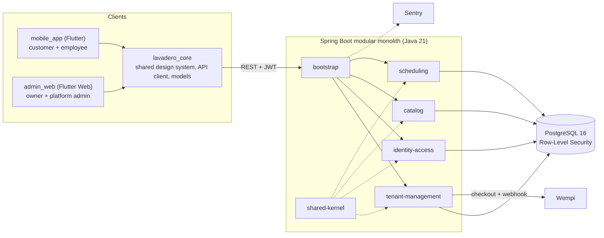

# Lavadero

**Multi-tenant SaaS for car wash businesses**: customers book services from their phone, employees run the daily agenda and service checklists, and owners manage branches, catalog, plans and reports from the web.

A Spring Boot modular monolith plus two Flutter apps, designed, built and operated by one developer.

[](https://github.com/Marlon-Trujillo-Jaramillo/lavadero/actions/workflows/backend-ci.yml)
[](https://github.com/Marlon-Trujillo-Jaramillo/lavadero/actions/workflows/flutter-ci.yml)


## Highlights

- **Modular monolith with DDD bounded contexts**: `tenant-management`, `identity-access`, `catalog` and `scheduling` are separate Gradle modules, each with Clean Architecture layers (`domain → application → infrastructure → interfaces`). The [ADR](docs/adr/0001-modular-monolith.md) explains why this beats microservices for a one-person team.
- **Architecture enforced by tests**: ArchUnit checks layer dependencies and module boundaries on every build, so the architecture can't silently decay.
- **Tenant isolation in the database**: every tenant-scoped table uses PostgreSQL **Row-Level Security** (`FORCE ROW LEVEL SECURITY`) on top of Hibernate filters. Integration tests run against a real Postgres with **Testcontainers** to prove that one tenant can never read another's data.
- **Payments**: subscription plans charged through **Wompi** (Colombian payment gateway), with integrity signatures and an idempotent webhook (a unique external transaction id per payment).
- **Security**: input limits on every public signup endpoint (email format, 8–128 character passwords to also cap Argon2 work), JWT access tokens + rotating refresh tokens with reuse detection (a reused token revokes the whole chain), Argon2 password hashing, role-based access (`SUPER_ADMIN`, `ADMIN_TENANT`, `EMPLEADO`, `CLIENTE`), and data scoped per branch for employees.
- **Observability**: Sentry on the backend and in both Flutter apps; Spring Boot Actuator health checks.
- **Database migrations**: Flyway, versioned per module, with indexes for every foreign key and lookup column.
- **Performance review**: 30 techniques checked one by one against the code ([spec 007](docs/specs/007-rendimiento.md)). Measured and fixed an N+1 (9 → 2 SQL statements when listing employees, guarded by a test), gzip responses, slow-request logging, lazy lists and unused dependencies removed.
- **CI**: GitHub Actions runs the full backend build (unit, architecture and Testcontainers RLS tests) plus `flutter analyze` and `flutter test` for the apps and the shared package.

## Architecture



Each module looks like this:

```
modules/scheduling/src/main/java/com/lavadero/scheduling/
├── domain/          aggregates, value objects (Money…), repository ports. No framework code.
├── application/     one use case per operation (commands, DTOs), transactions
├── infrastructure/  JPA entities and adapters, RLS-aware persistence
└── interfaces/      REST controllers (no try/catch; errors are mapped globally)
```

## Features

| Area | What it does |
|---|---|
| Self-service signup | A car wash creates its account from the web (business, main branch and owner account in one transaction) and lands in its dashboard ([spec 008](docs/specs/008-registro-lavaderos.md)) |
| Tenants and branches | Each car wash is a tenant with one or more branches (sucursales) and their capacity |
| Catalog | Services with prices and durations, managed by the owner |
| Scheduling | Customers book by branch and time slot; employees see and run the day's agenda |
| Service checklist and incidents | Employees go through a checklist per service and report incidents |
| Dashboard and reports | Sales and booking reports for the owner |
| Plans and subscriptions | SaaS plans paid with Wompi |

Each feature has a written spec in [`docs/specs/`](docs/specs) describing scope, decisions and how it was verified.

## Tech stack

| Layer | Technology |
|---|---|
| Backend | Java 21, Spring Boot 3, Spring Security, Spring Data JPA / Hibernate, Flyway, jjwt, Argon2 |
| Database | PostgreSQL 16 with Row-Level Security |
| Testing | JUnit 5, ArchUnit, Testcontainers |
| Apps | Flutter (Android, iOS, Web), Riverpod (`Notifier`), Dio, go_router, no code generation |
| Payments and monitoring | Wompi, Sentry |
| Build and CI | Gradle (Kotlin DSL, convention plugins in `buildSrc`), GitHub Actions, Docker Compose |

## Repository layout

```
backend/            Spring Boot modular monolith (Gradle multi-project)
  bootstrap/          application entry point and configuration
  modules/            bounded contexts: tenant-management, identity-access, catalog, scheduling
  shared-kernel/      cross-module building blocks
  architecture-tests/ ArchUnit rules
mobile_app/         Flutter app for customers and employees (dev / staging / prod flavors)
admin_web/          Flutter Web app for owners and the platform admin
packages/lavadero_core/  shared Flutter package: design system, API client, models
infra/              docker-compose for local development
docs/               ADRs, feature specs and the local development guide
```

## Running locally

Requires Java 21, Docker and Flutter.

```bash
# 1. Database
docker compose -f infra/docker-compose.yml up -d postgres

# 2. Backend (applies Flyway migrations on startup). The JWT secret is never committed:
export LAVADERO_SECURITY_JWT_SECRET="$(openssl rand -base64 32)"
cd backend && ./gradlew :bootstrap:bootRun --args='--spring.profiles.active=dev'
curl http://localhost:8080/actuator/health   # {"status":"UP"}

# 3. Apps
cd admin_web && flutter run -d chrome --dart-define=API_BASE_URL=http://localhost:8080
cd mobile_app && flutter run -t lib/main_dev.dart --dart-define=API_BASE_URL=http://localhost:8080
```

Tests: `cd backend && ./gradlew build` (Testcontainers needs Docker running).

The full guide, with demo data and troubleshooting, is in [`docs/desarrollo-local.md`](docs/desarrollo-local.md).

## AI-assisted engineering

This project is built with Claude Code as a pair programmer, with the rules and reviewers written down in the repo so the AI follows the same standards as a human contributor:

- **Project contract** ([`CLAUDE.md`](CLAUDE.md)): non-negotiable conventions for the backend (Clean Architecture per module, one use case per operation, value objects, indexed foreign keys, read-only transactions) and for Flutter (Riverpod without codegen, repository pattern, design tokens only).
- **Specialist reviewer agents** ([`.claude/agents/`](.claude/agents)) that run after every relevant change:
  - `rls-guardian` audits every migration and JPA entity for tenant isolation. It encodes a real incident found during development: the app connected as a Postgres superuser, which silently bypasses Row-Level Security, so runtime queries now use a dedicated non-superuser role.
  - `architecture-guardian` checks module layering, Gradle wiring and cross-module boundaries.
  - `flutter-reviewer` checks state management, navigation and design-system usage.
- **Project skills** ([`.claude/skills/`](.claude/skills)): a whole-repo `quality-audit` (design consistency, SOLID drift, performance) and reference playbooks for multi-tenant SaaS and Postgres.
- **Decisions before code**: every feature starts as a written spec in [`docs/specs/`](docs/specs) and every structural decision as an [ADR](docs/adr). The AI implements against the spec; the tests, ArchUnit rules and reviewers verify it.
- **Guardrails on the workstation**: hooks block secrets from being written to files, block force pushes and destructive shell commands, and auto-format code.

## Roadmap

- Event-driven integration between modules (transactional outbox + Kafka) for notifications and reporting
- Deployment on AWS (RDS, S3, containers)
- Email verification on signup

## Author

**Marlon Trujillo Jaramillo**, Software Developer, Medellín, Colombia
[GitHub](https://github.com/Marlon-Trujillo-Jaramillo) · [LinkedIn](https://www.linkedin.com/in/marlon-trujillo-5b661734a/)
